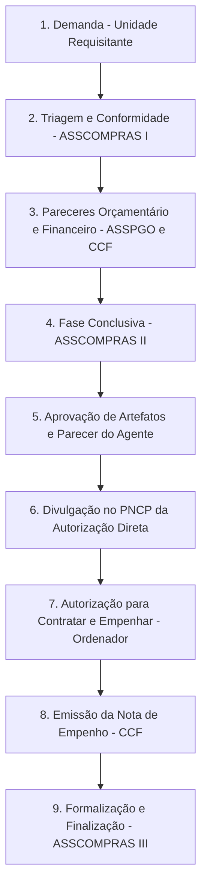

# Roteiro — Inexigibilidade de Licitação: Cursos, Treinamentos e Capacitações (Art. 74, III, "f")

> **Síntese / Escopo:**  
> Roteiro prático sequencial para a instrução e tramitação de processos de contratação direta por **Inexigibilidade de Licitação** voltados à capacitação e aperfeiçoamento de pessoal (art. 74, III, alínea "f", da Lei nº 14.133/2021).  
> Sistematiza o rito adotado na Coordenadoria de Licitações e Contratos (CLC/MPPI), considerando as peculiaridades desse nicho: inviabilidade de competição por notória especialização, substituição de contrato formal por Nota de Empenho (art. 95), rito sumário de pequeno valor com dispensa de parecer jurídico (Ato PGJ nº 1.383/2024) e de controle prévio da CONINT (Ato PGJ nº 1.480/2025), além do controle rigoroso de prazos operacionais prévios ao início das aulas.

---

## 📌 Particularidades Deste Rito (Atenção Prévia)

1. **Inviabilidade de Competição e Notória Especialização (art. 74, III, "f" e § 3º):**  
   Não se realiza cotação ordinária com 3 concorrentes. O objeto é singular pela metodologia/ementa e pelo prestígio do profissional ou instituição formadora.
2. **Vinculação Subjetiva Obrigatória (art. 74, § 4º):**  
   O Termo de Referência **deve vincular expressamente** os docentes indicados, vedando sua substituição unilateral por profissionais de qualificação distinta.
3. **Justificativa de Preço pelo art. 23, § 4º c/c IN nº 65/2021 (art. 7º, § 1º):**  
   Comprova-se a conformidade de preços mediante tabela pública do curso, propostas comerciais padrão, notas fiscais emitidas a outros órgãos públicos ou pessoas físicas no último ano, e notas de empenho anteriores.
4. **Substituição do Termo de Contrato por Nota de Empenho (art. 95, I e II):**  
   Por se tratar de serviço educacional de curta duração, entrega imediata e valor usualmente abaixo dos limites do art. 75, dispensa-se minuta e termo formal de contrato. A Nota de Empenho substitui o contrato para todos os efeitos legais.
5. **Rito Sumário de Pareceres (Ato PGJ nº 1.383/2024 e Ato PGJ nº 1.480/2025):**  
   Se o valor global for inferior aos limites do art. 75, II da Lei 14.133/2021:
   - **Parecer Jurídico individualizado da Assessoria Jurídica:** DISPENSADO.
   - **Parecer prévio individualizado da Controladoria Interna (CONINT):** DISPENSADO.
6. **Controle de Prazos Críticos:**  
   Verificar a data de início do curso, o prazo limite estipulado no TR para o envio da listagem formal dos inscritos (matrículas) e a validade da certidão de FGTS/CRF da contratada.

---

## 🧭 Fluxo Sequencial Passo a Passo

---

### ETAPA 1: UNIDADE REQUISITANTE (Fase Preparatória)
- [ ] **1.1. PCA Vigente:** Verificar se a capacitação consta no Plano de Contratações Anual (PCA). Se não constar, solicitar inclusão/autorização da PGJ.
- [ ] **1.2. DFD:** Elaborar Documento de Formalização da Demanda (DFD), justificando a correlação do treinamento com as atribuições funcionais dos servidores e os objetivos estratégicos do órgão.
- [ ] **1.3. ETP:** Inserir a **Justificativa de Dispensa de ETP** com base no art. 28, § 2º, do Decreto Estadual nº 21.872/2023.
- [ ] **1.4. Mapa de Riscos:** Elaborar Mapa e Matriz de Riscos da contratação.
- [ ] **1.5. Termo de Referência (TR):** Elaborar TR contendo:
  - Justificativa legal (art. 74, III, "f");
  - Carga horária, datas, horários e plataforma síncrona;
  - Cláusula de substituição de contrato por Nota de Empenho (art. 95);
  - Cláusula de vinculação obrigatória dos docentes indicados (art. 74, § 4º);
  - Prazos para envio da relação de inscritos e critérios de frequência mínima para certificação (mínimo 75%);
  - Indicação do Fiscal Técnico e Administrativo do treinamento.
- [ ] **1.6. Proposta e Ementa:** Anexar a proposta comercial oficial e o plano de curso pedagógico completo.
- [ ] **1.7. Pesquisa e Mapa de Preços:** Anexar notas fiscais/empenhos de outros contratantes e confeccionar o **Mapa Comparativo de Preços** fundamentado no art. 23, § 4º da Lei 14.133/2021 c/c IN nº 65/2021.
- [ ] **1.8. Habilitação e Regularidade:** Juntar atos constitutivos/estatuto, ata de eleição/posse da diretoria, CNH do representante, cartão CNPJ, certidão federal (CPEN), estadual, municipal (ou justificativa), FGTS (CRF), trabalhista (CNDT) e certidão negativa de falência/recuperação judicial.
- [ ] **1.9. Remessa:** Encaminhar à Coordenadoria de Licitações e Contratos (CLC).

---

### ETAPA 2: ANÁLISE PRELIMINAR — ASSCOMPRAS I
- [ ] **2.1. Recebimento e Cadastro:** Receber o processo e cadastrar na planilha de acompanhamento da CLC.
- [ ] **2.2. Portarias Obrigatórias:** Anexar a Portaria da Equipe de Planejamento da unidade e a Portaria dos Agentes de Contratação do MPPI.
- [ ] **2.3. Consultas Cadastrais:** Emitir e juntar a Consulta Consolidada de Licitantes Inidôneos/Impedidos (TCU, CNJ, CEIS e CNEP) e consulta SICAF.
- [ ] **2.4. Atos de Dispensa:** Juntar o Ato PGJ nº 1.383/2024 (dispensa de parecer jurídico) e o Ato PGJ nº 1.480/2025 (dispensa de CONINT prévia).
- [ ] **2.5. Análise de Conformidade:** Avaliar a documentação. Se houver pendências insanáveis imediatas, expedir ofício de diligência/devolução. Estando regular a essência:
- [ ] **2.6. Solicitação Orçamentária e Financeira:** Confeccionar o documento `Solicitação de Parecer Orçamentário e Financeiro - CLC` (modelo padronizado) assinado pelo Agente de Contratação e remeter à ASSPGO.

---

### ETAPA 3: PARECERES INICIAIS (ASSPGO e CCF)
- [ ] **3.1. Parecer Orçamentário (ASSPGO):** Emissão de parecer atestando a existência de saldo e dotação orçamentária compatível (Fonte 500, Elemento 3.3.90.39).
- [ ] **3.2. Parecer Financeiro (CCF):** Emissão de parecer atestando disponibilidade financeira real para a despesa.
- [ ] **3.3. Retorno:** Retorno dos autos à ASSCOMPRAS.

---

### ETAPA 4: ANÁLISE CONCLUSIVA E APROVAÇÃO — ASSCOMPRAS II
- [ ] **4.1. Parecer do Agente de Contratação:**  
  Confeccionar o `Parecer do Agente de Contratação` (modelo padronizado da CLC), contendo:
  - Relatório sucinto da demanda e valores;
  - Quadro sinóptico de todos os artefatos com seus respectivos links SEI;
  - Enquadramento material e subjetivo no art. 74, III, "f", e §§ 3º e 4º;
  - Razão da escolha e justificativa de preço (art. 23, § 4º);
  - Regularidade da habilitação e certidões;
  - Justificativa da incidência dos Atos PGJ 1.383/2024 e 1.480/2025;
  - Registro da substituição de contrato por Nota de Empenho (art. 95);
  - Atesto conclusivo e encaminhamento ao Ordenador de Despesas.
- [ ] **4.2. Aprovação de Artefatos (14.133):**  
  Confeccionar a minuta de `Aprovação de Artefatos - 14.133` preenchendo todos os campos e links para assinatura do Chefe de Gabinete / Ordenador de Despesas (art. 18 do Dec. Estadual 21.872/2023 c/c art. 72, VIII, Lei 14.133/2021).
- [ ] **4.3. Autorização para Contratar e Empenhar:**  
  Confeccionar a minuta de `Autorização para Contratar e Empenhar`, consolidando a qualificação da entidade, dados bancários, dotação e determinação de envio à CCF.
- [ ] **4.4. Remessa ao Gabinete:** Enviar os autos para colheita de assinatura do Chefe de Gabinete / Ordenador de Despesas.

---

### ETAPA 5: PUBLICIDADE LEGAL PRELIMINAR E EMPENHO
- [ ] **5.1. Divulgação no PNCP:**  
  Com a Aprovação de Artefatos / Autorização assinada, cadastrar e divulgar o ato de contratação direta no Portal Nacional de Contratações Públicas (PNCP - Compras.gov).
- [ ] **5.2. Juntada do Comprovante:** Anexar aos autos o extrato gerado no PNCP (`Publicação - Ato que autoriza a Contratação Direta`).
- [ ] **5.3. Envio à CCF:** Com a `Autorização para Contratar e Empenhar` assinada pelo Ordenador, remeter os autos à Coordenadoria de Contabilidade e Finanças.
- [ ] **5.4. Emissão da Nota de Empenho:** CCF emite e anexa a Nota de Empenho ordinária (2026NE...).

---

### ETAPA 6: FINALIZAÇÃO E GESTÃO — ASSCOMPRAS III
- [ ] **6.1. Comunicação ao Fornecedor:** Enviar a Nota de Empenho e a relação nominal dos servidores inscritos à instituição formadora (observando o prazo limite do TR).
- [ ] **6.2. Portaria de Fiscalização:** Providenciar e juntar a portaria de designação da fiscalização setorial/técnica.
- [ ] **6.3. Publicações Finais Obrigatórias:**
  - Publicar a contratação no PNCP (prazo legal de até 10 dias úteis, art. 72, parágrafo único, Lei 14.133/2021);
  - Cadastrar o empenho/contratação no sistema TCE-PI (Licitações Web) no prazo de até 10 dias úteis da emissão;
  - Disponibilizar no Portal da Transparência do MPPI.
- [ ] **6.4. Manifestação de Finalização de Atribuições:** Elaborar despacho conclusivo da ASSCOMPRAS.
- [ ] **6.5. Remessa para Gestão/Execução:** Encaminhar os autos à unidade requisitante/fiscal para acompanhamento da realização do curso, frequência e atesto das notas fiscais para pagamento posterior.

---

## 📊 Matriz Rápida de Documentos no SEI

| Ordem | Tipo de Documento no SEI | Elaborador | Assinante |
|:---:|:---|:---:|:---:|
| 1 | Documento de Formalização da Demanda (DFD) | Requisitante | Equipe Requisitante |
| 2 | Justificativa de Dispensa de ETP | Requisitante | Equipe Requisitante |
| 3 | Mapa de Risco e Matriz de Risco | Requisitante | Equipe Requisitante |
| 4 | Termo de Referência | Requisitante | Requisitante / Coordenação |
| 5 | Mapa Comparativo de Preços | Requisitante | Equipe Requisitante |
| 6 | Solicitação de Parecer Orçamentário e Financeiro | ASSCOMPRAS | Agente de Contratação |
| 7 | Parecer Orçamentário | ASSPGO | Analista / Assessor PGJ |
| 8 | Parecer Financeiro | CCF | Coordenador CCF |
| 9 | **Parecer do Agente de Contratação** | ASSCOMPRAS | **Agente de Contratação** |
| 10 | **Aprovação de Artefatos - 14.133** | ASSCOMPRAS | **Ordenador de Despesas** |
| 11 | Extrato PNCP (Ato que Autoriza Contratação) | ASSCOMPRAS | Sistema PNCP |
| 12 | **Autorização para Contratar e Empenhar** | ASSCOMPRAS | **Ordenador de Despesas** |
| 13 | Nota de Empenho | CCF | CCF |
| 14 | Ofício / Confirmação de Inscrição | ASSCOMPRAS | Agente / Requisitante |
| 15 | Portaria de Fiscalização | CLC / Gabinete | Autoridade Competente |
| 16 | Manifestação de Conclusão das Atribuições | ASSCOMPRAS | Agente de Contratação |
